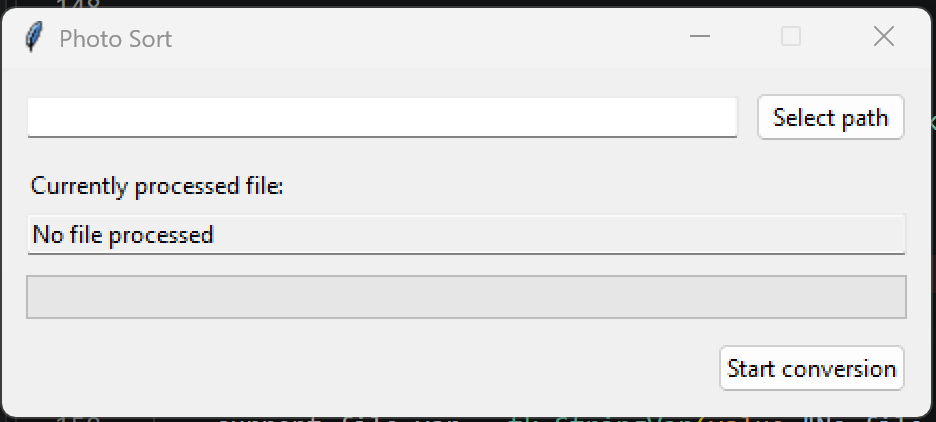

# Photosort
[](https://www.python.org/)
[](LICENSE)

A Python script to rename my personal photos based on the EXIF data.

The photos are then given names based on the date they were taken and the location name, which is compiled using the geolocation data and [Geopy](https://geopy.readthedocs.io/en/stable/) help.

## Usage

### Command line

Pass the photo folder as an argument to process it directly:

```powershell
python sort.py "C:\Photos"
```

Run without an argument to open the graphical interface, or use `python sort.py --help` to display the command-line options.

### Graphical interface



- **Select path** opens a folder picker and fills in the selected photo folder.
- **Start conversion** starts processing that folder. The current filename appears in the read-only field, and the progress bar tracks the conversion.


